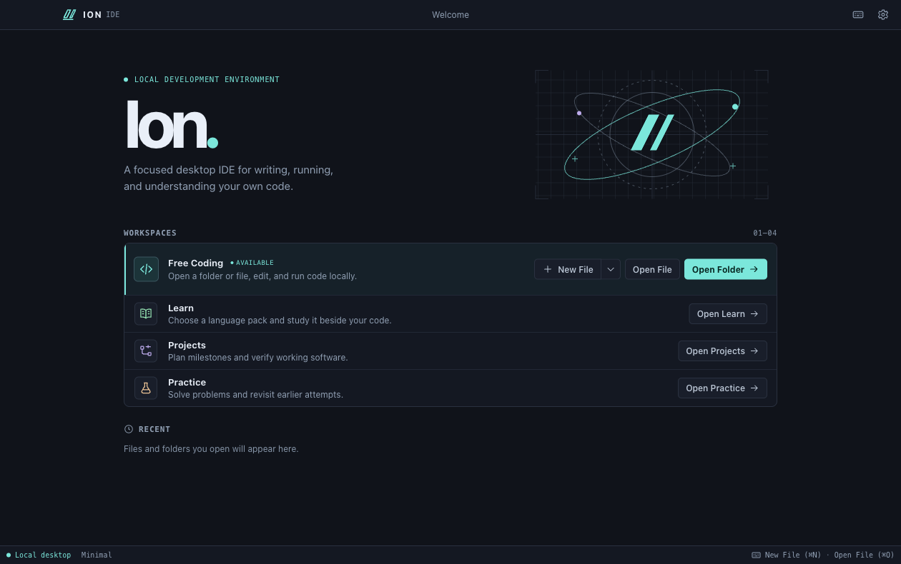
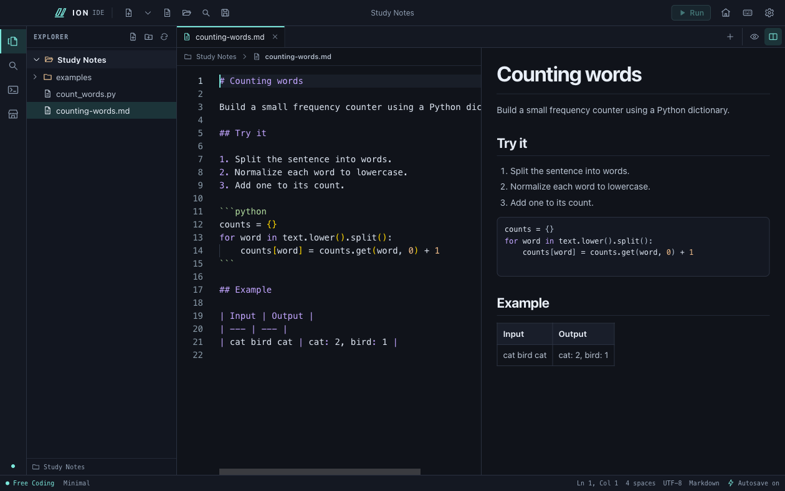

# Ion IDE

Ion IDE is a personal project by [Vaddi Srisanth](https://github.com/Vaddi-Srisanth). It is a standalone desktop IDE for writing, running, and understanding your own code. Everyone is welcome to download it, test it, and share feedback.

Free Coding gives you a regular editor. Learn, Projects, and Practice are optional workspaces beside that same editor. Editing, local execution, lessons, practice problems, and saved plans work offline. The optional AI planner and GitHub update checks need an internet connection.

## Download and install

Once a release is published, open its **Assets** section and choose the installer for your computer. [GitHub Releases](https://github.com/Vaddi-Srisanth/Ion_IDE/releases)

| Platform | 0.9.4 installer | How to install |
| --- | --- | --- |
| macOS 13+ on Apple Silicon (M-series) | `Ion-IDE-0.9.4-mac-arm64.dmg` | Open the `.dmg`, drag **Ion IDE** to **Applications**, then open it from Applications. |
| Windows x64 preview | `Ion-IDE-0.9.4-windows-x64-setup.exe` | Run the downloaded setup, then open **Ion IDE** from Start. |

Apple Silicon has native runtime coverage. Windows is a preview target with native runtime verification pending. Both installers bundle the desktop runtime. Install a language toolchain separately when you want to compile or run code. The Mac build is ad-hoc signed and has no Apple notarization. The Windows setup is unsigned. Your operating system may show a publisher or security prompt. [Windows platform differences](docs/windows/FEATURE_PARITY.md)

Use **Preferences → Updates** to check GitHub Releases and download the installer for this computer. Ion checks the download against GitHub’s SHA-256 digest and reveals the verified file in Downloads. Save your work and quit Ion before opening the installer. Automatic checking at launch is opt-in.

If you find a problem, include your Ion version, operating system, processor architecture, and steps to reproduce it. Use a small example you can share publicly. [Report an issue](https://github.com/Vaddi-Srisanth/Ion_IDE/issues/new)



## What Ion can do

| Workflow | Features |
| --- | --- |
| **Edit code** | Monaco syntax highlighting, multiple tabs, Find and Replace, Go to Line, configurable fonts and indentation, line numbers, word wrap, and starter templates for C, C++, Java, Python, JavaScript, TypeScript, HTML, CSS, Go, Rust, Shell, and SQL. |
| **Manage files and navigate** | Open files or folders, create and rename items, move items to Trash or Recycle Bin, revisit recent work, use Command Palette and Quick Open, or search saved workspace text with ripgrep and jump to a result. |
| **Protect edits** | Configurable autosave, detection of external edits, Save As conflict protection, local crash recovery, and reopening the last session with its tabs, selections, and scroll positions. Large UTF-8 files get a paged read-only viewer. |
| **Run code** | Use local C, C++, Java, Python, and JavaScript toolchains. The Run Console shows compile errors, live output, duration, and exit status, with interactive input, Stop, Rerun, and Clear. Java supports companion sources, packages, and local JAR dependencies. Offline Maven and Gradle are documented in the Java section. |
| **Preview web and Markdown** | Preview local HTML, CSS, and JavaScript together. Switch Markdown between Source, Preview, and live resizable Split View. Preview includes tables, lists, tasks, links, workspace images, and highlighted code fences. |
| **Work with notebooks** | Open, edit, reorder, and save `.ipynb` cells. Read Markdown, metadata, saved text, images, and static tables, or inspect the JSON source. Use a local Jupyter kernel to run one cell, cells above it, or all cells. |
| **Read documents beside code** | View PDF, DOCX, XLSX, and CSV in read-only tabs with format-specific navigation and search. Use a resizable split beside source, or open the original in the default app. macOS also supports static PPTX slides through an optional LibreOffice installation. |
| **Learn a language** | Install curated packs from the offline Marketplace or import a validated local pack. Browse Topics first, with explanations, examples, key APIs, common mistakes, and exercises. The C pack adds explanations for recognized GCC and Clang diagnostics, repeated-error feedback, and local history. |
| **Plan and verify projects** | Attach a versioned local specification to a workspace, edit milestones and acceptance criteria, track manual progress, and approve C stdin/stdout tests. In Full Mode, approved tests can run on save. An optional HTTPS planner uses your own key to propose a specification for review. |
| **Practice problems** | Choose a language, topic, and difficulty to get a ready-to-use offline problem with a statement, constraints, examples, and sample tests. Start one of 27 built-in challenges, create custom problems, and save notes, test results, and multiple solution attempts in C, C++, Java, Python, or JavaScript. |
| **Make it yours** | Switch among five light and dark themes, follow system appearance, or create, import, and export custom theme JSON. Resize or hide panels, change keyboard shortcuts, and choose the Minimal or Full resource profile. |
| **Manage local data and releases** | Export settings, themes, learning data, and project records to a local profile backup. Use the update panel to check GitHub and download a checksum-verified installer. |

## macOS setup

If you build Ion locally, quit the app and run `npm run install:mac` from the project to update your copy in `~/Applications`. It replaces the app at the same path and keeps the previous binary at `~/Library/Application Support/Ion IDE Rollback/Ion IDE.zip`. Settings and recovery drafts live separately in Application Support.

Turn on **Preferences → Window → Open in full screen** to launch future Ion windows in macOS full screen. Use **View → Toggle Full Screen** to change the current window without changing the launch preference.

Ion appears in Finder’s **Open With** menu for Jupyter notebooks, plain text, and supported source files. To make it the default for a file type, select a file in Finder, press **⌘I**, choose **Ion IDE** under **Open with**, and click **Change All**. Both `.py` and `.python` open with Python highlighting and can run with a local Python interpreter.

Install Apple's Command Line Tools if you want to compile C or C++:

```sh
xcode-select --install
```

Ion detects Apple Clang when Command Line Tools or Xcode is selected. It can also use Homebrew GCC from standard Homebrew locations. Install a JDK for Java, Python 3 for Python, or Node.js for JavaScript. Editing and file management work without these tools. For Windows toolchain setup, see the [Windows guide](docs/windows/README.md).

## Build from source

Use Node.js 22.13 or later and npm. The initial dependency and Electron downloads require network access. On macOS, install Xcode Command Line Tools for C execution and packaging the app icon.

```sh
npm ci
npm run build
npm start
```

For renderer hot reload, run `npm run dev`. Restart it after edits to the main process or preload. Use `npm run install:mac` to update a local Mac installation, `npm run package:dmg` for the macOS disk image, or `npm run package:win` for Windows setup. Packages land in `release/`. [Windows build instructions](docs/windows/BUILD.md)

## Write and run code

Choose **Open Folder** for a workspace explorer, **Open File** to edit a file directly, or **New File** to start with an untitled tab. Create, rename, and move files or folders to Trash through the explorer. Use the editor's Find and Replace commands for the current file.

**New File** starts a C draft in Free Coding and uses your selected language in Learn when a starter is available. The arrow beside New File opens the starter picker for C, C++, Java, Python, JavaScript, TypeScript, HTML, CSS, Go, Rust, Shell, SQL, or a blank file. Explorer’s **Create file** dialog offers starter code when it recognizes the filename extension. Use **Insert Starter Code** in the editor toolbar or Command Palette to fill an existing empty source file in one undoable step.

Existing files autosave after a short pause by default. An untitled file needs its first Save. When a file's contents change on disk before Save, Ion pauses autosave for that tab and preserves your edits. Choose **Save As** with a different filename to keep both versions, or **Reload** to discard the editor edits and read the disk version. Metadata-only changes leave normal text autosave running. Use Preferences to change editor font size, tab width, line numbers, wrapping, and autosave delay. Drag the explorer or output divider to resize it, or toggle the panes from the toolbar or View menu. Preferences and recent items stay in `preferences.json` in your local profile.

Replacing an occupied Save As destination requires explicit confirmation. Ion checks the destination revision again before publishing the new file. If Ion encounters an unreadable or newer preferences format, it leaves the file in place and keeps autosave off while editing remains available. Keep a copy of that profile before changing settings files or using another Ion version.

Choose **Resume Session** on Welcome to reopen the previous workspace, ordered tabs, active tab, and source selections and scroll positions. **Keep Drafts and Quit** saves checkpoints before closing. After a crash, Resume Session puts matching recovered edits back in their tab positions. **Recover edits** also opens checkpoints independently. Recovered drafts are detached, so you can compare them with the disk version and choose where to save. The last completed checkpoint survives a process crash. Edits made just before a crash may be newer than the last write. Ion stores up to 64 recovery drafts in your profile’s `recovery` folder, up to 16 MiB each. Save or discard a draft to clear its recovery copy.

Press **Run** or **F5** with a C, C++, Java, Python, or JavaScript file open. Ion chooses a local toolchain, saves pending edits by default, compiles when needed, and focuses the **Run Console**. Type directly into that console when the program asks for input. Compiler messages and program output appear there along with exit status and duration. The console offers scrollback, **Stop**, **Rerun**, and **Clear**. Preferences controls save-before-run and whether the console keeps previous runs. macOS uses a pseudo-terminal. Windows sends interactive input one line at a time. [Windows console details](docs/windows/FEATURE_PARITY.md)

Ion requests trust for each new source file in a window. Window trust follows edits saved through Ion. With **Save before Run** enabled, Ion asks you to reload an open file if its saved revision changed externally. With the setting off, Run uses the current saved file and external changes require renewed consent. Select the C pack in Learn to enable explanations for recognized C diagnostics. All languages keep their raw diagnostics in the console.

| Source | Local execution |
| --- | --- |
| C and C++ | Clang or GCC compiles the active source file and its included headers. |
| Java | An installed JDK compiles the active source and resolves companion sources, packages, and local `lib/*.jar` dependencies. Ion finds the entry point in freshly compiled class metadata. |
| Maven and Gradle Java | On macOS, open the project folder. Ion uses the detected build and its main source set and runtime classpath. It asks before each build and uses locally available tools and caches. On Windows, run Maven or Gradle from a separate terminal. |
| Python and JavaScript | Local Python 3 and Node.js run the active script. |

Maven uses its cached compiler plugin and, for projects with dependencies, its cached dependency-classpath plugin. Gradle can use an installed CLI or the matching already-extracted Gradle wrapper distribution and cached dependencies. Maven and Gradle write their usual project build output. Projects with custom launch tasks, unusual source sets, or additional JVM flags may need their own build workflow. [Maven CLI options](https://maven.apache.org/ref/3-LATEST/maven-embedder/cli.html) · [Gradle offline mode](https://docs.gradle.org/current/userguide/dependency_caching.html#sec:offline-mode)

Use **Preview** on an HTML, CSS, or JavaScript file to open a separate offline web preview. Relative styles, scripts, and supported assets load from the opened workspace. CSS and JavaScript use the nearest `index.html` or `index.htm` inside that workspace. Press ⌘R on macOS or Ctrl+R on Windows in the preview window to reload it from disk.

### Keyboard navigation

| Action | macOS | Windows |
| --- | --- | --- |
| Command Palette | ⌘⇧P | Ctrl+Shift+P |
| Quick Open | ⌘P | Ctrl+P |
| Search in Files | ⌘⇧F | Ctrl+Shift+F |
| Go to Line | ⌃G | Ctrl+G |
| Find / Replace | ⌘F / ⌘⌥F | Ctrl+F / Ctrl+H |
| New File / Open File / Open Folder | ⌘N / ⌘O / ⌘⇧O | Ctrl+N / Ctrl+O / Ctrl+Shift+O |
| Save / Close Tab | ⌘S / ⌘W | Ctrl+S / Ctrl+W |
| Previous / Next Tab | ⌘⇧[ / ⌘⇧] | Ctrl+Shift+[ / Ctrl+Shift+] |
| Toggle Explorer / Toggle Run Console | ⌘B / ⌘J | Ctrl+B / Ctrl+J |
| Run / Stop | F5 or ⌘↩ / ⇧F5 | F5 or Ctrl+Enter / Shift+F5 |

Change Ion command bindings in **Preferences → Keyboard Shortcuts**. `Mod` means Command on macOS and Ctrl on Windows. Leave a binding blank to remove it or choose **Restore Default**. Ion rejects collisions and keeps system editing shortcuts available. In the palette, use **Toggle Document Split** and **Focus Document Split Divider** to place a document beside source code and resize the split with arrow keys. The workbench has one source editor. Quick Open searches on demand, visits up to 5,000 entries across 12 directory levels, skips hidden and common generated directories, and returns up to 40 matches.

**Search in Files** runs a literal, case-insensitive search with the bundled ripgrep executable. Results are grouped by file. Select a result to jump to its line. Search respects the workspace's `.gitignore` files, skips hidden files, symlinks, document and notebook formats, and common generated directories, and searches files up to 2 MiB. It searches saved text. Stop a query with **Cancel Search** or close the panel. A query uses one temporary process and reports when its result, output, or time limit is reached. [ripgrep guide](https://github.com/BurntSushi/ripgrep/blob/master/GUIDE.md)

Local programs and build scripts run with your user permissions. Only run code and builds you trust. Ion passes arguments directly, uses a temporary output directory for standalone builds, and applies a 15-second compiler timeout, a two-minute project build timeout, a five-minute interactive program timeout, and a 256 KiB combined output limit. Stop terminates the launched process and attempts to clean up its children. Running code can access files and resources available to your account.

## Read-only document tabs

Open a supported file from the explorer or **Open File**. Choose **Split View** to keep the document beside a source tab. Drag the divider or focus it and use the arrow keys. **Open in Default Application** opens the original file in the associated desktop app. Ion previews files locally and preserves the original bytes.

| Format | Preview | Input limit |
| --- | --- | ---: |
| PDF | Scrollable pages, page jump, zoom, fit, and text search for PDFs with a text layer | 96 MiB / 2,000 pages |
| DOCX | Headings, formatted paragraphs, tables, and PNG/JPEG images, with zoom and search within the current section | 32 MiB |
| XLSX | Worksheet selection, paged cell grid, address jump, zoom, and cell search. Formula results come from saved values | 48 MiB |
| CSV | Paged cell grid with zoom, search, and quoted commas and line breaks. Detects comma, semicolon, tab, and pipe. Reads UTF-8, BOM-marked UTF-16, and Windows-1252 | 24 MiB / 100,000 rows |
| PPTX | On macOS with LibreOffice, static slide visuals, thumbnails, previous/next, slide number, zoom, fit, and keyboard-controlled full-screen presentation. On Windows, use Open in Default Application | 48 MiB / 400 slides for preview |

Word preview reflows content into sections. Complex Word layout and unsupported embeds may be omitted. Excel displays raw numeric values, and the grid bounds long cell previews. PDF search uses embedded text. Scanned pages remain viewable as images.

### PowerPoint setup and rendering

Install a current **LibreOffice** in Applications for in-IDE PowerPoint previews on macOS. When the engine is unavailable, Ion shows the setup instruction and keeps the default-app action available. The installer for Ion leaves LibreOffice as a separate, optional installation. [LibreOffice downloads](https://www.libreoffice.org/download/download-libreoffice/)

Ion runs headless Impress on a private copy and uses the PDF viewer for the resulting slides. This preserves diagrams, text placement, and supported static charts while keeping the conversion engine out of the normal editor session. The converter runs with network access blocked, restricted file access, a disposable profile, and a timeout. Ion blocks macros, OLE controls, and external content during preflight. Embedded chart data must be static. [LibreOffice command-line options](https://help.libreoffice.org/latest/en-US/text/shared/guide/start_parameters.html)

Slide fidelity depends on LibreOffice’s import and available fonts. Full PowerPoint layout compatibility, animation playback, transitions, and media playback are outside this static preview. macOS Quick Look can supply file thumbnails, while reproducing Office layout in an in-app OOXML renderer would require implementing a separate slide engine. Headless conversion lets Ion reuse the same PDF paging and canvas limits for the slide stage and thumbnail rail. [Apple Quick Look thumbnail API](https://developer.apple.com/documentation/quicklookthumbnailing/qlthumbnailgenerator)

## Markdown preview

Open a `.md` or `.markdown` tab and choose the eye icon in the editor toolbar. The code icon returns to Source with the same cursor, scroll position, and undo history. The columns icon opens a resizable split that updates from your unsaved edits. Press **⌘⇧M** or **Ctrl+Shift+M** to toggle the preview, and **⌘⌥⇧M** or **Ctrl+Alt+Shift+M** to toggle the split. Ion remembers the viewing mode for up to 100 Markdown files on this device.

The preview renders GitHub-flavored Markdown, including tables, tasks, links, and highlighted code blocks. Relative file links and images resolve from the Markdown file within the open workspace folder. Supported image formats are PNG, JPEG, GIF, WebP, and BMP, up to 5 MiB and 8 megapixels each. External HTTP(S) links open in your browser when clicked. Remote and unsupported images display their alt text. Ion bounds the preview of large or unusually complex Markdown and keeps the full source in the editor.



## Jupyter notebooks

Open an `.ipynb` file from the explorer or **Open File**. Ion opens a dedicated notebook tab with ordered cells, Python highlighting, Markdown, raw cells, execution counts, and collapsible outputs. Saved streams, tracebacks, static HTML tables, PNG, JPEG, and safe SVG render locally. **Metadata** shows the notebook’s metadata. **Open as JSON** switches to the text editor for small notebooks and pages through raw source for larger ones.

Select a cell and choose **Edit cell**. Ion uses one Monaco widget for the selected cell. The toolbar supports adding cells, moving them, changing their type, deleting them, and undoing or redoing edits. Save and autosave check the disk revision and preserve untouched notebook fields. If the file changes outside Ion, choose **Save As** to keep your changes. **Recover edits** restores checkpointed notebook edits in a detached tab after a crash. Notebook undo history is kept while the view is mounted. Ion releases the parsed notebook when the view closes or you switch to another tab, unless it is running a cell.

**Run cell**, **Run above**, and **Run all** use an installed Python environment with `jupyter_client` and `ipykernel`. Choose **Kernel** to see discovered environments or pick a local Python interpreter, including one inside a virtual environment. Ion asks for trust before starting execution. Variables persist until you stop or restart the kernel. The default lifetime stops the kernel when you close its tab. Choose **Until window closes** to retain an idle kernel when closing a tab. Viewing and editing work without Python, and the app uses a local kernel connection without a Jupyter web server. The notebook format and kernel protocol follow the Jupyter specifications. [Notebook format](https://nbformat.readthedocs.io/en/latest/format_description.html) · [Kernel messaging](https://jupyter-client.readthedocs.io/en/latest/messaging.html)

Notebook files support UTF-8 nbformat 4, up to 16 MiB and 10,000 cells. Ion allows two live notebook kernels per window and two minutes per cell. Long outputs and images have preview limits. Interactive JavaScript widgets, rich math layout, and Python `input()` prompts are outside this release. User-initiated Python runs with your user account’s permissions, just like the standalone runner.

## Themes

Open **Preferences → Appearance** to switch among Ion Dark, Ion Light, Midnight Violet, Graphite Ember, and Paper Studio, or choose **Automatic** to follow system appearance. The selection applies immediately to the workbench, editor, console, and optional panels. The accent controls are available on Ion Dark and Ion Light, including when Automatic selects either palette.

Use **Create Theme…** to start with the current palette and customize workbench colors, editor colors, and syntax. **Export Current…** saves the palette as a portable version 1 Ion JSON file. You can edit an exported file locally and **Import…** it as a new theme. Theme files accept predefined color keys and six-digit hex colors. Ion checks text contrast before installing them. Custom themes live in your local profile and work offline.

## Resource profiles

The default **Minimal Mode** keeps editing, manual runs, and on-demand offline workspaces available. **Full Mode** also enables the opt-in online planner and approved C tests on save. Change profiles in Preferences without closing your files. [Resource profiles](RESOURCE_PROFILES.md)

## Optional workspaces

- **Learn** starts in Topics. Install a pack from Marketplace, then choose it in the Learn language picker. The C pack also exposes Clang and GCC explanations and local diagnostic history.
- **Projects** attaches a versioned, locally stored specification to a folder. Create a plan offline and edit milestones or the full specification. Tests compare a saved C program's stdin, stdout, and exit status. Review and approve a test before choosing **Run Test**. Manual progress stays separate from current test evidence. Rerun after changing headers or other dependencies.
- **Practice** opens on a challenge browser. Choose a language or topic, then Easy, Medium, or Hard. Ion supplies the statement, constraints, examples, and four sample tests for each of 27 offline challenges. Choose a solution language and select **Start** to open or resume an attempt in C, C++, Java, Python, or JavaScript. Your attempts, notes, and test results live in **Saved**, alongside any custom problems.

Use the activity rail to collapse a panel. Drag its divider or use the arrow keys with the divider focused to resize it. Return to Welcome and open a file, folder, or new tab for Free Coding.

In Full Mode, **Online Planner** in Projects accepts an HTTPS OpenAI-compatible endpoint, model ID, and your own API key. The key is encrypted through Electron's OS-backed credential storage. The online confirmation shows the provider and text before sending. Ion sends only the project description and planning instructions and lets you review the returned specification. Plans contain planning text and declarative test definitions. They never write source files or run shell commands. All existing plans and local tests remain usable with the network off.

### Learning Marketplace

Open **Marketplace** using the storefront icon on the left activity rail. Search the catalog, choose **Install**, then choose the pack in **Learn → Language** or select **Use in Learn**. A new profile starts with no installed or selected language. Topics opens first. The 11 packs cover C, C++, Java, Python, JavaScript, TypeScript, Go, Rust, SQLite, HTML, and CSS. Each guide pairs short explanations with examples, key APIs, and a practice task. The catalog and installed lessons work offline.

**Import pack** accepts a local UTF-8 JSON file up to 256 KiB. Use the [Python pack](src/main/learning/catalog/python.json) as a format example and choose an unused pack ID. Ion validates the data and displays lesson content as text. Installing a learning pack leaves toolchain setup separate.

## Local profile backup

**Preferences → Local Data → Export Local Profile…** creates a versioned copy of settings, custom themes, installed learning packs, the selected learning language, learning history, and project metadata in a folder you choose. The default profile lives in `~/Library/Application Support/Ion IDE/` on macOS and `%APPDATA%\Ion IDE\` on Windows. Keep source workspaces, practice attempts, and unsaved drafts in your separate backup workflow. [Portable profile instructions](PORTABLE_PROFILE.md)

## Checks

```sh
npm run test:regression
npm run package:dmg
node scripts/verify-mac-release.mjs
npm run bench:run-console
npm run bench:resources
npm run bench:editor-residency -- --mode distinct --trials 3
npm run test:markdown -- --coupling /path/to/Coupling.md
node scripts/test-notebook.mjs --edit --kernel-python /path/to/python
node scripts/evaluate-project-plans.mjs
```

The full macOS regression suite needs working local Clang/Clang++, Java, Python, and Node.js. It uses disposable profiles and synthetic workspaces. LibreOffice is optional for the default suite and required for the full PowerPoint rendering check. The planning evaluation checks four reviewed reference plans offline. [Release checklist](RELEASE_CHECKLIST.md)

## Measured performance

These are observations from the final 0.9.4 public preview on an Apple M3 with 24 GiB RAM, compared with the preserved 0.9.3 build. The production harness used three fresh and three warm profile launches with OS caches intact, a six-second idle sample, and a synthetic 1,000-file project. The runs were recorded separately.

| Workload | 0.9.3 | 0.9.4 |
| --- | ---: | ---: |
| Fresh / warm time to Welcome, medians | 413 / 392 ms | 435 / 360 ms |
| Welcome idle CPU, share of one logical core | 0.44% | 0.42% |
| Welcome idle memory, summed RSS / attributed footprint | 419 / 122 MiB | 420 / 122 MiB |
| One C file, summed RSS / attributed footprint | 505 / 343 MiB | 507 / 337 MiB |
| Ten tabs, summed RSS / attributed footprint | 520 / 365 MiB | 522 / 365 MiB |
| Medium project, summed RSS / attributed footprint | 548 / 385 MiB | 550 / 386 MiB |

Summed RSS covers the full application process tree and can count shared mappings more than once. Attributed footprint uses macOS’s per-process memory accounting. Timing measures the visible Welcome marker. The numbers describe this hardware and workload. [Reproduction commands, additional workloads, and thresholds](PERFORMANCE.md)

## Current limits

- C and C++ use single translation-unit builds. The Run Console is attached to the launched program. Build systems for C and C++, a general-purpose shell, and debugging are outside this runner.
- The source editor edits UTF-8 files up to 2 MiB, with up to 64 open tabs. Ion keeps up to three live Monaco text models. Monaco can retain up to 20 MiB of detached edit history in total for inactive tabs in the same session and restores it only when the buffer matches. Large edits can exhaust that allowance. Closing or reloading a tab, restarting the app, or changing the file on disk can reset its undo history. Hot models retain richer state such as folds. Resume Session preserves source selections and scroll, while console output and undo history start fresh. The explorer loads on expansion and supports a manual refresh. Symlinks inside the explorer are skipped.
- Larger UTF-8 files up to 128 MiB open in a read-only preview. Each page reads at most 64 KiB plus the bytes needed to finish a character, so a preview cannot replace the file or run it. Syntax editing and Search in Files are available for files within the editing limit. If an edited buffer grows past 2 MiB, Save reports the limit. Use **Save As** to keep a complete copy up to 16 MiB, or shorten the buffer. Recovery can checkpoint up to 16 MiB. Notebooks use their own limits.
- File saves check the disk revision immediately before atomic replacement where supported. The revision check and replacement are separate operations, so independent writers can still race at publication.
- Project verification supports single-file C console behavior. Practice verifies console input and output in C, C++, Java, Python, and JavaScript with the respective local toolchain. It accepts up to eight samples and twenty attempts per problem. It compiles once per batch where needed, then runs each input in a separate process with a private temporary directory. Non-C project plans can be recorded manually. Live provider results depend on the configured endpoint and model.
- The Mac installer targets Apple Silicon. The Windows installer targets x64 and has its own [platform notes](docs/windows/KNOWN_ISSUES.md). Linux and Intel Mac installers are outside this release.

See [PROJECT_AUDIT.md](PROJECT_AUDIT.md) for current release evidence and [ROADMAP.md](ROADMAP.md) for the release gates. [ARCHITECTURE_PERFORMANCE_AUDIT.md](ARCHITECTURE_PERFORMANCE_AUDIT.md) compares runtime alternatives.

## Contributing and security

See the development and testing guide before proposing changes. Report security issues privately. Ion has no project license granting general reuse, modification, or redistribution of its source. Bundled dependencies carry their own licenses and notices. [Contribution guide](CONTRIBUTING.md) · [Security reporting](SECURITY.md) · [Release audit](docs/RELEASE_AUDIT.md) · [Dependency notices](docs/DISTRIBUTION.md) · [Changelog](CHANGELOG.md)
