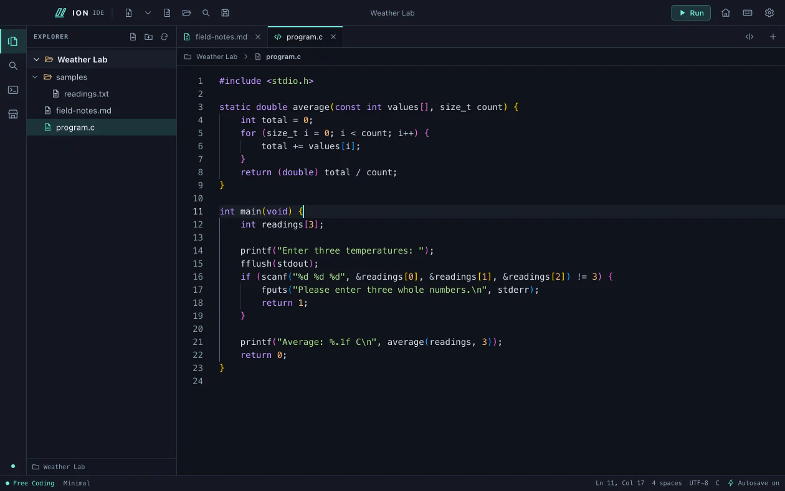
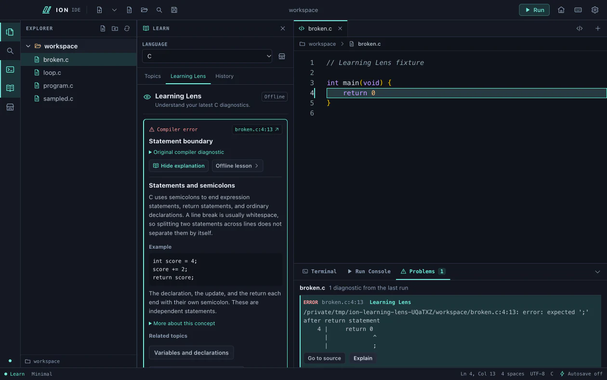
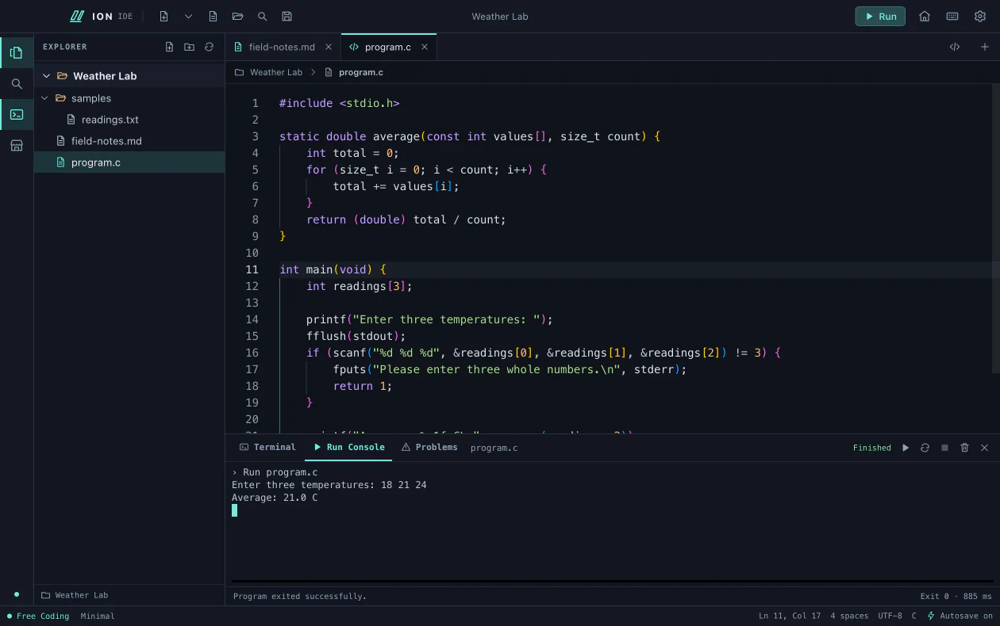
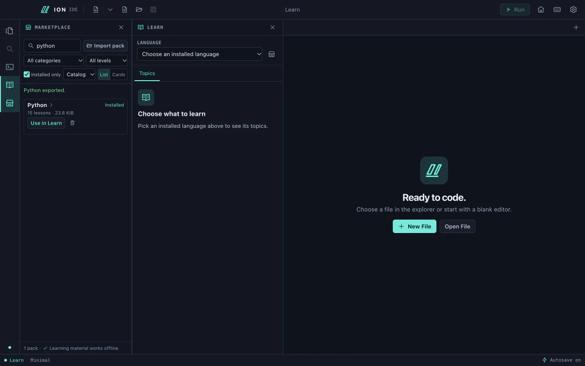
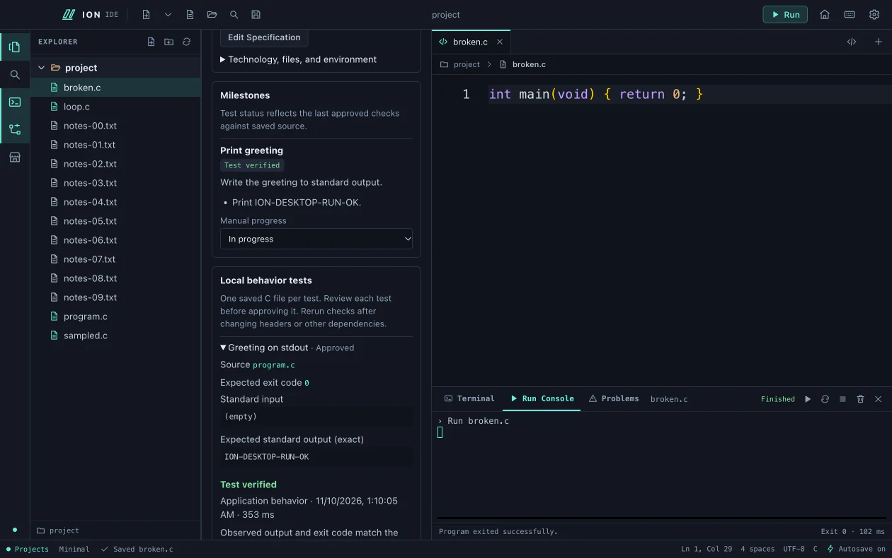
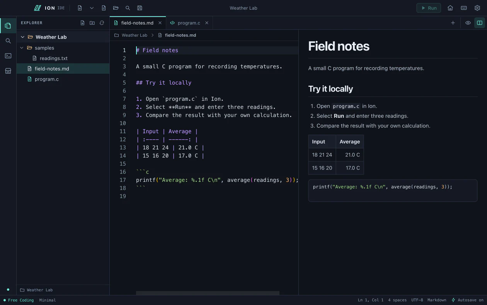
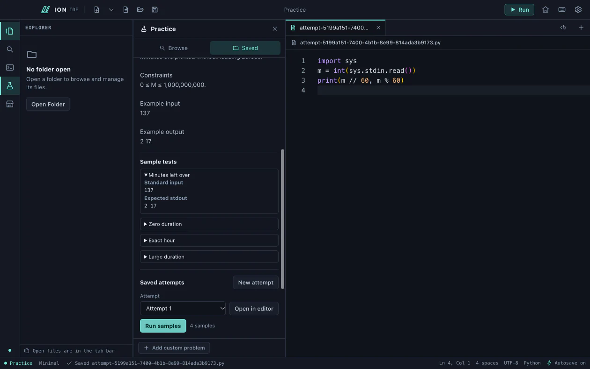
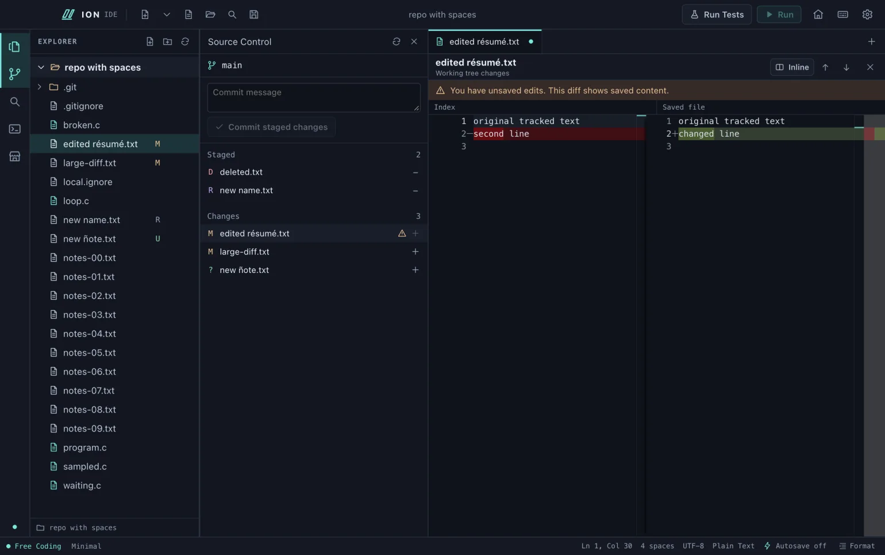
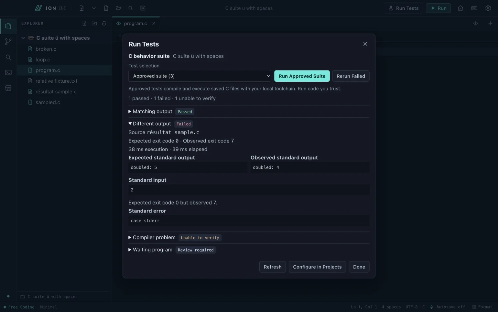

# Ion IDE

**An offline-first desktop IDE for learning by coding.**

*Write code. Understand errors. Learn offline.*

Ion is a personal project by Vaddi Srisanth for students and developers who want to run their own code and understand what went wrong. Free Coding is a regular editor. Learn, Projects, and Practice open beside it when you need them. Your source files, lessons, notes, and progress stay local. The Electron workbench loads the editor and optional tools on demand. You can use the IDE without an account or API key. [Architecture](ARCHITECTURE.md)

The 0.9.6 stabilization candidate adds reproducible Git configuration-race tests, private index publication, cancellation cleanup, and measured memory recovery. The [engineering audit](ENGINEERING_AUDIT.md#stabilization-follow-up-from-9adcdea) records the security boundary, native checks and remaining gates. [Performance evidence](PERFORMANCE.md)

[Download](#download-and-install) · [Quick start](#quick-start) · [Features](#features) · [Screenshots](#screenshots) · [Performance](#performance) · [Contributing](#contributing)



## Download and install

Get the installers and SHA-256 checksums from the [latest GitHub release](https://github.com/Vaddi-Srisanth/Ion_IDE/releases/latest). The latest public installer is [version 0.9.5](docs/releases/0.9.5.md). The 0.9.6 development source adds Source Control, saved Run Tests, the expanded theme picker, and the new navigation.

| Platform | Installer | Install |
| --- | --- | --- |
| macOS 13 or later, Apple Silicon | `Ion-IDE-<version>-mac-arm64.dmg` | Open the disk image, drag **Ion IDE** into **Applications**, then launch it there. |
| Windows x64 preview | `Ion-IDE-<version>-windows-x64-setup.exe` | Run setup, then open **Ion IDE** from Start. |

The macOS disk image is ad-hoc signed and unnotarized. Gatekeeper may block it on first open. Windows setup is unsigned and can trigger SmartScreen or organizational policy. Compare the installer’s SHA-256 with `SHA256SUMS` from the same release before opening it. Windows x64 automation runs on Windows Server 2025. Manual Windows 10/11 coverage remains open. [Apple Gatekeeper guidance](https://support.apple.com/en-us/102445) · [Windows readiness](WINDOWS_RELEASE_READINESS.md)

Editing, previews, bundled lessons, local plans, and practice work offline. Install the language toolchain you want to run separately. The optional online planner and update checks use the network.

| To run | Install separately |
| --- | --- |
| C or C++ | Apple Clang via `xcode-select --install` on macOS, or a compatible Clang/GCC toolchain. On Windows, use GNU-compatible GCC or Clang. |
| Java | A JDK with `java` and `javac`. |
| Python or JavaScript | Python 3 or Node.js, respectively. |
| Source Control | Git on macOS or Git for Windows. Use a local repository you trust. |
| Jupyter cells or PowerPoint previews | A Python environment with `jupyter_client` and `ipykernel` for cell execution. On macOS, LibreOffice for static PowerPoint previews. |

[macOS setup](docs/USAGE.md#macos-setup) · [Windows toolchains](docs/windows/DEPENDENCIES.md)

### Build from source

Install Git, Node.js 22.13 or later, and npm. On macOS, install Xcode Command Line Tools with `xcode-select --install` to compile the native file and terminal helpers. The initial dependency downloads require internet access.

```sh
git clone https://github.com/Vaddi-Srisanth/Ion_IDE.git
cd Ion_IDE
npm ci
npm run build
npm start
```

[Development and packaging](docs/USAGE.md#build-from-source) · [Windows build prerequisites](docs/windows/BUILD.md) · [macOS signing](docs/macos/SIGNING.md)

## Quick start

1. Install Ion and a C compiler, then launch Ion.
2. Choose **Open Folder** for your code folder or **New File**. Save the file as `hello.c`.
3. Write a small program that asks for input.

   ```c
   #include <stdio.h>

   int main(void) {
       char name[80];

       fputs("What's your name? ", stdout);
       fflush(stdout);
       if (fgets(name, sizeof name, stdin)) {
           printf("Hello, %s", name);
       }
       return 0;
   }
   ```

4. Click **Run** or press **F5**. Review the local execution prompt.
5. In **Run Console**, type your name and press **Enter**. Look for the greeting and the exit status.
6. Remove the semicolon after `fflush(stdout)`, save, and run again. Read the compiler message in Run Console.
7. Install the C pack from **Marketplace** and select it in **Learn**. Rerun the broken file. Choose **Explain** in **Problems** for a recognized compiler error. Restore the semicolon and run again.

[Run Console guide](docs/USAGE.md#write-and-run-code) · [Keyboard shortcuts](docs/USAGE.md#keyboard-navigation)

## Features

### Learning Lens

For supported C compiler errors, Ion connects the source location, the original diagnostic in **Problems**, and an installed offline lesson. The explanation card shows a short example. **Explain Again** appears if the issue recurs after a meaningful edit. A successful recompilation can record the issue as resolved in local history. That event describes the compiler result. Ambiguous diagnostics keep their original message and tell you when a reliable explanation is unavailable. Toggle the Lens in **Preferences → Run Console**. [Learning Lens guide](docs/USAGE.md#learning-lens)

### Run, learn, and verify

| Capability | Coverage in the development build |
| --- | --- |
| **One-click Run** | C, C++, Java, Python, and JavaScript via Node.js. Run Console handles live output and stdin, compiler messages, Stop, Rerun, and exit status. |
| **Smart Java** | Local Java snippets and optional JDK-backed semantic completion, live diagnostics, signatures, and navigation. [Java editing guide](docs/USAGE.md#java-suggestions-and-diagnostics) |
| **Bundled learning packs** | 162 lessons across 19 packs. Core syntax, common APIs, examples, exercises, and selected mini-projects. Install or import packs offline. |
| **Diagnostic explanations** | C with GCC or Clang has the Learning Lens workflow. Reviewed subsets for C++, Java, Python, and JavaScript also link to relevant installed lessons. |
| **Run Tests** | Save C behavior tests in Projects, approve their local compiler and program commands, then run a selected case or the approved suite from the toolbar. See expected and actual output, exit codes, timing, compiler locations, and saved evidence. [Run Tests guide](docs/USAGE.md#saved-run-tests) |
| **Practice** | Pick a topic, language, and difficulty for 27 built-in challenges with sample tests. Save notes, results, and multiple attempts. Run samples in the five languages listed above. |

The catalog covers C, C++, Java, Python, JavaScript, TypeScript, Go, Rust, Swift, C#, Bash, Ruby, Perl, HTML, CSS, SQLite, JSON, XML, and YAML. A pack provides lessons. Executing its examples depends on the installed toolchain and Ion's Run coverage. [Pack catalog and authoring](docs/LEARNING_PACKS.md)

### Everyday coding

- **Get started offline.** New profiles can watch the first-launch intro or skip straight to Welcome. Setup offers a language starter and the four workspaces. Reduced motion uses the static setup.
- **Edit and navigate.** Monaco, starter files, multiple tabs, command palette, Quick Open, saved-file workspace search, configurable shortcuts, relative path breadcrumbs, and Back/Forward for source jumps. Turn on **Smart C/C++** in Preferences to use locally installed clangd for definitions and references. Background indexing stays off, so results cover the current translation unit. **Language Support** in Preferences and the command palette lists capabilities and tool requirements independently of syntax highlighting.
- **Format source.** Use the status bar or a shortcut to format the current buffer with an installed local tool. Changes apply as one undoable edit. [Formatting guide](docs/USAGE.md#format-a-source-file)
- **Review and commit locally.** Open a repository root and select **Source Control** for branch and file status, Explorer badges, staged and working-tree diffs, Stage, Unstage, and local commits. Use inline or side-by-side diffs while keeping the source editor open. [Source Control guide](docs/USAGE.md#source-control)
- **Protect work.** Autosave, revision-aware saves, external-change prompts, crash recovery, session reopening, and local export for settings, themes, learning history, and project metadata.
- **Use a shell.** The integrated Terminal opens on demand, with multiple sessions, search, and bounded scrollback. It uses your configured shell on macOS and Command Prompt via ConPTY on Windows. Run Console stays separate.
- **Read beside code.** Live Markdown split preview, local web preview, editable Jupyter notebooks with optional local execution, and read-only PDF, DOCX, XLSX, CSV, and compatible macOS PowerPoint previews.
- **Make it yours.** Sixteen built-in palettes include two high-contrast options. Open **Preferences → Appearance → Browse Themes** or **Color Theme** in the command palette. Search, preview, favorite, and apply themes offline. Cancel restores the current selection. Automatic appearance, local JSON import/export, and Minimal and Full Mode remain available.
- **Plan locally or online.** Write a plan offline or request a reviewable specification through an optional HTTPS OpenAI-compatible provider with your own key. Ion asks before sending the project description. The planner proposes milestones and test definitions for review. You write the code.
- **Update when you choose.** Check in Preferences → Updates, or opt in to checks on launch. When a compatible GitHub release is available, the title bar offers a checksum-verified installer download that you can open yourself.

[Usage guide](docs/USAGE.md) · [Resource profiles](RESOURCE_PROFILES.md) · [Local profile export](PORTABLE_PROFILE.md)

## Screenshots

The published 0.9.5 screenshots and development previews use disposable sample workspaces.



<details>
<summary>Run Console, Marketplace, Projects, Markdown, and Practice</summary>

**Run Console** with input and output from a locally compiled C program.



**Marketplace** with an installed Python learning pack.



**Projects** with a locally verified C test.



**Markdown** in a live source and preview split.



**Practice** with a challenge and the Python sample-test interface.



</details>

<details>
<summary>Source Control and saved Run Tests in the 0.9.6 development build</summary>





</details>

## Performance

Production-build measurements include the Electron process tree. CPU is a percentage of one logical core during the indicated workload. Startup measures time to Welcome with the OS file cache intact.

| Ion version | Host | Measured workload | Memory metric | CPU | Fresh / warm startup |
| --- | --- | --- | --- | --- | --- |
| 0.9.4 public preview | Apple M3, 24 GiB, macOS 27.2 | Welcome, six-second idle sample | 418.59 MiB summed RSS, 123.00 MiB macOS-attributed footprint | 0.29% | 375.21 / 366.50 ms |
| 0.9.5 with Learning Lens | Apple M3, 24 GiB, macOS 27.2 (26B123) | C compiler error and explanation open, 1.5-second CPU sample | 540.8 MiB summed RSS | 0.65% | 399.6 ms fresh profile |
| 0.9.5 before Learning Lens | Xeon Platinum 8370C, ~16 GiB, Windows Server 2025 x64 (26100) | Welcome, roughly three-second idle sample | 301.1 MiB summed working set, 137.5 MiB private bytes | 0.00% at sample resolution | 536 / 412 ms |

Summed RSS and working set can count shared resident pages more than once. macOS-attributed footprint and Windows private bytes use different accounting. Each row describes its own host and workload. [macOS methodology](PERFORMANCE.md) · [Windows methodology](WINDOWS_RELEASE_READINESS.md#native-windows-performance)

Development workflow benchmarks cover the closed and open Git panel, large diffs, and saved test runs. Native verification, platform differences, and outstanding hardware tests are tracked separately. [Benchmark report](PERFORMANCE.md#git-and-saved-run-tests) · [Platform matrix](docs/windows/FEATURE_PARITY.md) · [Coverage audit](TEST_COVERAGE_AUDIT.md)

## Limitations

- **Debugging and builds.** Ion has no integrated debugger. One-click multi-file C/C++ builds require an explicit source list for one executable and one language. Use a shell for Make, CMake, MSVC, and custom build pipelines. Java Maven and Gradle integration relies on supported local tools, cached dependencies, and standard project layouts.
- **Learning and tests.** Diagnostic coverage is curated and depends on the compiler, language, and message. Project verification supports approved C console tests. Practice checks samples locally. Official submissions happen on the original practice site.
- **Source Control.** Open a repository or linked worktree root and explicitly trust its Git configuration for this workspace session. Diffs cover saved UTF-8 text up to 256 KiB and 12,000 lines per side. Use a terminal for binary files, repository-local filters, hooks, signed commits, conflicts, and remote operations.
- **Notebooks and documents.** Notebook execution requires a local Python kernel. Preview supports static outputs, with limitations for widgets, rich math, and `input()`. Office previews have layout limits. macOS PowerPoint uses LibreOffice for static slides. Windows opens PowerPoint externally.
- **Platforms and signing.** Packaged targets are Apple Silicon macOS and Windows x64 preview. Intel Mac and Linux installers are unavailable. On Windows, the source preview uses Command Prompt for its integrated Terminal. Use Windows Terminal for PowerShell. See the installer section for signing and OS coverage.
- **Recovery.** Crash recovery restores the last saved checkpoint, which can miss recent keystrokes. Undo history does not survive relaunch. A competing replacement detected during a save leaves the displaced version in an adjacent recovery file. Windows uses two safe moves and may retain the original under its backup name if the process is interrupted between them. Profile export excludes source workspaces, practice attempts, and recovery drafts. [File safety and recovery](docs/USAGE.md#file-safety-and-recovery)
- **Execution.** Programs and build scripts run with your account's permissions. Timeouts, output limits, and process cleanup bound the runner. Treat code, shell commands, and project builds as trusted before running them.

[Windows known issues](docs/windows/KNOWN_ISSUES.md) · [Release checklist](RELEASE_CHECKLIST.md) · [Roadmap](ROADMAP.md)

[Engineering audit](ENGINEERING_AUDIT.md) · [Renderer bottleneck report](BOTTLENECK_REPORT.md)

## Contributing

Ion is a personal project, and everyone is welcome to test the preview. Use the issue templates to report bugs or propose features. For learning packs, share an example, expected result, or a proposed correction. Documentation and translation proposals are welcome. Discuss source changes with the maintainer before opening a focused pull request with relevant test results. Report suspected vulnerabilities privately. [Open an issue](https://github.com/Vaddi-Srisanth/Ion_IDE/issues/new/choose) · [Contribution guide](CONTRIBUTING.md) · [Pack guide](docs/LEARNING_PACKS.md) · [Security policy](SECURITY.md) · [Changelog](CHANGELOG.md)

## License

Ion IDE is a public preview by [Vaddi Srisanth](https://github.com/Vaddi-Srisanth). The project has no license granting general reuse, modification, or redistribution of its source. Third-party components retain their licenses and attribution. [Distribution and third-party notices](docs/DISTRIBUTION.md)
