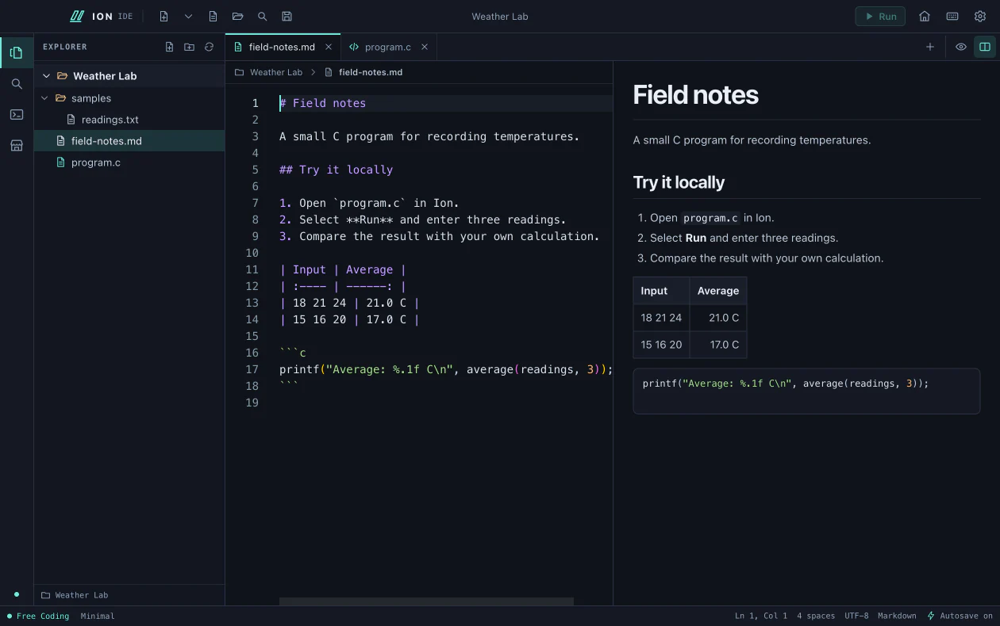

# Using Ion IDE

This guide follows the 0.9.5 source preview. See the [README](../README.md#download-and-install) for the currently published installers and their differences.

## First launch

A new local profile opens with the offline Ion introduction. Press **Escape** or click **Skip Intro** to go to setup, or choose **Skip Setup** to go straight to Welcome. With reduced motion enabled, setup uses a static layout. **Get Started** opens the language starter picker. You can also open a folder or choose Free Coding, Learn, Projects, or Practice. Ion checks for the chosen language's installed tools when you press **Run**.

To watch it again, choose **Preferences → Window → Replay Intro**. Replay returns to the current work. Opening a file through Finder or Windows Explorer takes precedence.

## macOS setup

If you build Ion locally, quit the app and run `npm run install:mac` from the project to update your copy in `~/Applications`. It replaces the app at the same path and keeps the previous binary at `~/Library/Application Support/Ion IDE Rollback/Ion IDE.zip`. Settings and recovery drafts live separately in Application Support.

Turn on **Preferences → Window → Open in full screen** to launch future Ion windows in macOS full screen. Use **View → Toggle Full Screen** to change the current window without changing the launch preference.

Ion appears in Finder’s **Open With** menu for Jupyter notebooks, plain text, and supported source files. To make it the default for a file type, select a file in Finder, press **⌘I**, choose **Ion IDE** under **Open with**, and click **Change All**. Both `.py` and `.python` open with Python highlighting and can run with a local Python interpreter.

Install Apple's Command Line Tools if you want to compile C or C++:

```sh
xcode-select --install
```

Ion detects Apple Clang when Command Line Tools or Xcode is selected. It can also use Homebrew GCC from standard Homebrew locations. Install a JDK for Java, Python 3 for Python, or Node.js for JavaScript. Editing and file management work without these tools. For Windows toolchain setup, see the [Windows guide](windows/README.md).

## Build from source

Use Node.js 22.13 or later and npm. The initial dependency and Electron downloads require network access. On macOS, install Xcode Command Line Tools for C execution and packaging the app icon.

```sh
npm ci
npm run build
npm start
```

For renderer hot reload, run `npm run dev`. Restart it after edits to the main process or preload. Use `npm run install:mac` to update a local Mac installation, `npm run package:dmg` for the macOS disk image, or `npm run package:win` for Windows setup. Packages land in `release/`. [Windows build instructions](windows/BUILD.md)

## Write and run code

Choose **Open Folder** for a workspace explorer, **Open File** to edit a file directly, or **New File** to start with an untitled tab. Create, rename, and move files or folders to Trash through the explorer. Use the editor's Find and Replace commands for the current file.

**New File** starts a C draft in Free Coding and uses your selected language in Learn when a starter is available. The arrow beside New File opens the starter picker for C, C++, Java, Python, JavaScript, TypeScript, HTML, CSS, Go, Rust, Shell, SQL, or a blank file. Explorer’s **Create file** dialog offers starter code when it recognizes the filename extension. Use **Insert Starter Code** in the editor toolbar or Command Palette to fill an existing empty source file in one undoable step.

### Java suggestions and diagnostics

In a Java tab, type a standard shortcut such as `sout`, `psvm`, `fori`, or `trycatch`. Use the arrow keys to choose a suggestion, then press Enter or Tab to insert it. Under **Preferences → Language tools**, turn off **Automatic suggestions** if you prefer to trigger them with Ctrl+Space.

Enable **Smart Java** in the same section and open a saved `.java` file. With a local JDK 17 or later, Ion can suggest members such as `System.out.println`, look up standard-library types such as `HashMap`, show method signatures, and check your current unsaved edits. Hover over an underline for the original javac message. Open **Problems** in the bottom panel to see live diagnostics and use **Go to source**. The last Run still has its own diagnostics.

Smart Java works offline and uses the installed JDK. It handles files up to 256 KiB and looks up on-disk workspace sources in the workspace root, `src`, `src/main/java`, and `src/test/java`. Go to Definition can follow local sources. Find References currently searches the active buffer. Maven and Gradle dependency resolution and cross-file references remain on the roadmap. Ion can insert a qualified name when you select a suggestion and leaves your import statements alone.

### Format a source file

Click **Format** beside Autosave, or press **Shift+Option+F** on macOS and **Shift+Alt+F** on Windows or Linux. The command also appears as **Format Document** in the command palette and **Preferences → Keyboard Shortcuts**. Ion formats the active buffer, including unsaved edits. Use one Undo to restore the previous text. Save and Autosave follow the existing editor settings. Press Escape to cancel a running formatter.

| Source | Local formatter |
| --- | --- |
| C and C++ | LLVM `clang-format`. Ion can find it through Xcode Command Line Tools on macOS. |
| Java | `clang-format`, with an optional `google-java-format` executable on PATH. Choose a formatter in **Preferences → Formatting**. |
| Python | Ruff or Black on PATH. Automatic selection prefers Ruff. |
| JavaScript, TypeScript, HTML, CSS, JSON, Markdown | Prettier 3 on PATH with Node.js. |
| SQL and other languages | Ion displays a status message when a formatter is unavailable. |

Install the formatter separately and reopen Ion from an environment where it is on PATH. Ion honors local `.clang-format` files and Python formatter settings in the workspace. Prettier uses EditorConfig and built-in parsers with declarative JSON settings from `.prettierrc`, `.prettierrc.json`, or the `prettier` field in `package.json`. Common indentation, quotes, trailing commas, and matching file overrides work with those JSON settings. JavaScript config files and plugins are outside Ion’s formatter integration. A standalone file can use settings from its containing directory. Untitled files use editor or tool defaults.

The command supports UTF-8 source up to 2 MiB and preserves the editor’s LF or CRLF convention and UTF-8 BOM. It stays disabled in read-only previews. Editing or changing tabs while a formatter is running cancels that request. A change on disk surfaces the normal conflict state before Ion applies any formatter output. The status bar shows missing dependencies, parse errors, and timeouts. [ClangFormat](https://clang.llvm.org/docs/ClangFormat.html) · [Ruff configuration](https://docs.astral.sh/ruff/configuration/) · [Prettier configuration](https://prettier.io/docs/configuration)

Existing files autosave after a short pause by default. An untitled file needs its first Save. When a file's contents change on disk before Save, Ion pauses autosave for that tab and preserves your edits. Choose **Save As** with a different filename to keep both versions, or **Reload** to discard the editor edits and read the disk version. Metadata-only changes leave normal text autosave running. Use Preferences to change editor font size, tab width, line numbers, wrapping, and autosave delay. Drag the explorer or output divider to resize it, or toggle the panes from the toolbar or View menu. Preferences and recent items stay in `preferences.json` in your local profile.

Replacing an occupied Save As destination requires explicit confirmation. Ion checks the destination revision again before publishing the new file. If Ion encounters an unreadable or newer preferences format, it leaves the file in place and keeps autosave off while editing remains available. Keep a copy of that profile before changing settings files or using another Ion version.

Choose **Resume Session** on Welcome to reopen the previous workspace, ordered tabs, active tab, and source selections and scroll positions. **Keep Drafts and Quit** saves checkpoints before closing. After a crash, Resume Session puts matching recovered edits back in their tab positions. **Recover edits** also opens checkpoints independently. Recovered drafts are detached, so you can compare them with the disk version and choose where to save. The last completed checkpoint survives a process crash. Edits made just before a crash may be newer than the last write. Ion stores up to 64 recovery drafts in your profile’s `recovery` folder, up to 16 MiB each. Save or discard a draft to clear its recovery copy.

Press **Run** or **F5** with a C, C++, Java, Python, or JavaScript file open. Ion chooses a local toolchain, saves pending edits by default, compiles when needed, and focuses the **Run Console**. Type directly into that console when the program asks for input. Compiler messages and program output appear there along with exit status and duration. The console offers scrollback, **Stop**, **Rerun**, and **Clear**. Preferences controls save-before-run and whether the console keeps previous runs. Ion uses a pseudo-terminal. On Windows, if the native helper or ConPTY API is unavailable, the Run Console labels its line-input fallback. [Windows console details](windows/FEATURE_PARITY.md)

Ion requests trust for each new source file in a window. Window trust follows edits saved through Ion. With **Save before Run** enabled, Ion asks you to reload an open file if its saved revision changed externally. With the setting off, Run uses the current saved file and external changes require renewed consent. Select the C pack in Learn to enable explanations for recognized C diagnostics. All languages keep their raw diagnostics in the console.

| Source | Local execution |
| --- | --- |
| C and C++ | Clang or GCC compiles the active source or the explicit source list in a workspace build file. |
| Java | An installed JDK compiles the active source and resolves companion sources, packages, and local `lib/*.jar` dependencies. Ion finds the entry point in freshly compiled class metadata. |
| Maven and Gradle Java | Open the project folder and run a Java source. Ion asks before each build and uses installed tools and cached dependencies. On Windows, install Maven 3.9.x or Gradle 8.10 through 9.x. [Windows Java setup](windows/DEPENDENCIES.md) |
| Python and JavaScript | Local Python 3 and Node.js run the active script. |

Maven uses its cached compiler plugin and, for projects with dependencies, its cached dependency-classpath plugin. Gradle uses an installed distribution and cached dependencies. On macOS it can also use a matching, already-extracted wrapper distribution. Maven and Gradle write their usual project build output. Projects with custom launch tasks, unusual source sets, or additional JVM flags may need their own build workflow. [Maven CLI options](https://maven.apache.org/ref/3-LATEST/maven-embedder/cli.html) · [Gradle offline mode](https://docs.gradle.org/current/userguide/dependency_caching.html#sec:offline-mode)

Use **Preview** on an HTML, CSS, or JavaScript file to open a separate offline web preview. Relative styles, scripts, and supported assets load from the opened workspace. CSS and JavaScript use the nearest `index.html` or `index.htm` inside that workspace. Press ⌘R on macOS or Ctrl+R on Windows in the preview window to reload it from disk.

### Multi-file C and C++ projects

Create `.ion/build.json` in an opened workspace folder. List the source files that link into one program. Use C or C++ for the whole list and forward slashes for workspace-relative paths. Include directories and tracked headers are optional.

```json
{
  "version": 1,
  "sources": ["src/main.c", "src/math.c"],
  "includeDirectories": ["include"],
  "headers": ["include/math.h"]
}
```

Save the build file, then press **Run** from any listed source. Ion asks for approval, builds into a private temporary directory, and runs only the executable from that build. **Save before Run** also saves edited listed sources and headers. A valid configuration leaves unlisted source files on the normal single-file path. Compiler messages appear in Run Console. Learning history stays scoped to single-file runs.

The build file supports up to 32 source files, 64 tracked headers, and 8 include directories. Use the integrated Terminal for Make, CMake, mixed-language projects, and custom compiler or linker arguments. Ion reads the build file when you run a source.

### Integrated Terminal

Use **View → Toggle Terminal** or select **Terminal** in the bottom panel. Ion opens the workspace directory or your home directory. On macOS and Linux it starts your account's configured shell and reads its startup configuration. On Windows it starts Command Prompt with AutoRun disabled. Open Windows Terminal separately for PowerShell workflows. Run Git, installed compilers, and interactive tools as you would from your system terminal. Your shell manages its command history.

Use **New Terminal** and the session selector to keep up to six shells open. Each session keeps 2,000 lines of scrollback. Drag the bottom divider to resize. Use **Find** or **Clear** on the toolbar, and use **⌘C** and **⌘V** to copy and paste on macOS. **Ctrl+C** interrupts the foreground job. Hiding the panel or switching to **Run Console** keeps Terminal sessions alive. **Close Terminal** ends the selected shell and its jobs. Closing the Ion window ends all of its sessions. A program that deliberately daemonizes into its own OS session can outlive the terminal.

**Run** and **F5** still open the separate Run Console for one-click code execution. On Windows, the integrated shell needs ConPTY. If it is unavailable, use a separate terminal for shell commands.

### Keyboard navigation

| Action | macOS | Windows |
| --- | --- | --- |
| Command Palette | ⌘⇧P | Ctrl+Shift+P |
| Quick Open | ⌘P | Ctrl+P |
| Search in Files | ⌘⇧F | Ctrl+Shift+F |
| Go to Line | ⌃G | Ctrl+G |
| Find / Replace | ⌘F / ⌘⌥F | Ctrl+F / Ctrl+H |
| New File / Open File / Open Folder | ⌘N / ⌘O / ⌘⇧O | Ctrl+N / Ctrl+O / Ctrl+Shift+O |
| Save / Close Tab | ⌘S / ⌘W | Ctrl+S / Ctrl+W |
| Previous / Next Tab | ⌘⇧[ / ⌘⇧] | Ctrl+Shift+[ / Ctrl+Shift+] |
| Toggle Explorer / Toggle Bottom Panel | ⌘B / ⌘J | Ctrl+B / Ctrl+J |
| Toggle / Focus Terminal | ⌘⇧J / ⌘⌥J | Ctrl+Shift+J / Ctrl+Alt+J |
| Run / Stop | F5 or ⌘↩ / ⇧F5 | F5 or Ctrl+Enter / Shift+F5 |

Change Ion command bindings in **Preferences → Keyboard Shortcuts**. `Mod` means Command on macOS and Ctrl on Windows. Leave a binding blank to remove it or choose **Restore Default**. Ion rejects collisions and keeps system editing shortcuts available. In the palette, use **Toggle Document Split** and **Focus Document Split Divider** to place a document beside source code and resize the split with arrow keys. The workbench has one source editor. Quick Open searches on demand, visits up to 5,000 entries across 12 directory levels, skips hidden and common generated directories, and returns up to 40 matches.

**Search in Files** runs a literal, case-insensitive search with the bundled ripgrep executable. Results are grouped by file. Select a result to jump to its line. Search respects the workspace's `.gitignore` files, skips hidden files, symlinks, document and notebook formats, and common generated directories, and searches files up to 2 MiB. It searches saved text. Stop a query with **Cancel Search** or close the panel. A query uses one temporary process and reports when its result, output, or time limit is reached. [ripgrep guide](https://github.com/BurntSushi/ripgrep/blob/master/GUIDE.md)

Local programs and build scripts run with your user permissions. Only run code and builds you trust. Ion passes arguments directly, uses a temporary output directory for standalone builds, and applies a 15-second compiler timeout, a two-minute project build timeout, a five-minute interactive program timeout, and a 256 KiB combined output limit. Stop terminates the launched process and attempts to clean up its children. Running code can access files and resources available to your account.

## Read-only document tabs

Open a supported file from the explorer or **Open File**. Choose **Split View** to keep the document beside a source tab. Drag the divider or focus it and use the arrow keys. **Open in Default Application** opens the original file in the associated desktop app. Ion previews files locally and preserves the original bytes.

| Format | Preview | Input limit |
| --- | --- | ---: |
| PDF | Scrollable pages, page jump, zoom, fit, and text search for PDFs with a text layer | 96 MiB / 2,000 pages |
| DOCX | Headings, formatted paragraphs, tables, and PNG/JPEG images, with zoom and search within the current section | 32 MiB |
| XLSX | Worksheet selection, paged cell grid, address jump, zoom, and cell search. Formula results come from saved values | 48 MiB |
| CSV | Paged cell grid with zoom, search, and quoted commas and line breaks. Detects comma, semicolon, tab, and pipe. Reads UTF-8, BOM-marked UTF-16, and Windows-1252 | 24 MiB / 100,000 rows |
| PPTX | On macOS with LibreOffice, static slide visuals, thumbnails, previous/next, slide number, zoom, fit, and keyboard-controlled full-screen presentation. On Windows, use Open in Default Application | 48 MiB / 400 slides for preview |

Word preview reflows content into sections. Complex Word layout and unsupported embeds may be omitted. Excel displays raw numeric values, and the grid bounds long cell previews. PDF search uses embedded text. Scanned pages remain viewable as images.

### PowerPoint setup and rendering

Install a current **LibreOffice** in Applications for in-IDE PowerPoint previews on macOS. When the engine is unavailable, Ion shows the setup instruction and keeps the default-app action available. The installer for Ion leaves LibreOffice as a separate, optional installation. [LibreOffice downloads](https://www.libreoffice.org/download/download-libreoffice/)

Ion runs headless Impress on a private copy and uses the PDF viewer for the resulting slides. This preserves diagrams, text placement, and supported static charts while keeping the conversion engine out of the normal editor session. The converter runs with network access blocked, restricted file access, a disposable profile, and a timeout. Ion blocks macros, OLE controls, and external content during preflight. Embedded chart data must be static. [LibreOffice command-line options](https://help.libreoffice.org/latest/en-US/text/shared/guide/start_parameters.html)

Slide fidelity depends on LibreOffice’s import and available fonts. Full PowerPoint layout compatibility, animation playback, transitions, and media playback are outside this static preview. macOS Quick Look can supply file thumbnails, while reproducing Office layout in an in-app OOXML renderer would require implementing a separate slide engine. Headless conversion lets Ion reuse the same PDF paging and canvas limits for the slide stage and thumbnail rail. [Apple Quick Look thumbnail API](https://developer.apple.com/documentation/quicklookthumbnailing/qlthumbnailgenerator)

## Markdown preview

Open a `.md` or `.markdown` tab and choose the eye icon in the editor toolbar. The code icon returns to Source with the same cursor, scroll position, and undo history. The columns icon opens a resizable split that updates from your unsaved edits. Press **⌘⇧M** or **Ctrl+Shift+M** to toggle the preview, and **⌘⌥⇧M** or **Ctrl+Alt+Shift+M** to toggle the split. Ion remembers the viewing mode for up to 100 Markdown files on this device.

The preview renders GitHub-flavored Markdown, including tables, tasks, links, and highlighted code blocks. Relative file links and images resolve from the Markdown file within the open workspace folder. Supported image formats are PNG, JPEG, GIF, WebP, and BMP, up to 5 MiB and 8 megapixels each. External HTTP(S) links open in your browser when clicked. Remote and unsupported images display their alt text. Ion bounds the preview of large or unusually complex Markdown and keeps the full source in the editor.



## Jupyter notebooks

Open an `.ipynb` file from the explorer or **Open File**. Ion opens a dedicated notebook tab with ordered cells, Python highlighting, Markdown, raw cells, execution counts, and collapsible outputs. Saved streams, tracebacks, static HTML tables, PNG, JPEG, and safe SVG render locally. **Metadata** shows the notebook’s metadata. **Open as JSON** switches to the text editor for small notebooks and pages through raw source for larger ones.

Select a cell and choose **Edit cell**. Ion uses one Monaco widget for the selected cell. The toolbar supports adding cells, moving them, changing their type, deleting them, and undoing or redoing edits. Save and autosave check the disk revision and preserve untouched notebook fields. If the file changes outside Ion, choose **Save As** to keep your changes. **Recover edits** restores checkpointed notebook edits in a detached tab after a crash. Notebook undo history is kept while the view is mounted. Ion releases the parsed notebook when the view closes or you switch to another tab, unless it is running a cell.

**Run cell**, **Run above**, and **Run all** use an installed Python environment with `jupyter_client` and `ipykernel`. Choose **Kernel** to see discovered environments or pick a local Python interpreter, including one inside a virtual environment. Ion asks for trust before starting execution. Variables persist until you stop or restart the kernel. The default lifetime stops the kernel when you close its tab. Choose **Until window closes** to retain an idle kernel when closing a tab. Viewing and editing work without Python, and the app uses a local kernel connection without a Jupyter web server. The notebook format and kernel protocol follow the Jupyter specifications. [Notebook format](https://nbformat.readthedocs.io/en/latest/format_description.html) · [Kernel messaging](https://jupyter-client.readthedocs.io/en/latest/messaging.html)

Notebook files support UTF-8 nbformat 4, up to 16 MiB and 10,000 cells. Ion allows two live notebook kernels per window and two minutes per cell. Long outputs and images have preview limits. Interactive JavaScript widgets, rich math layout, and Python `input()` prompts are outside this release. User-initiated Python runs with your user account’s permissions, just like the standalone runner.

## Themes

Open **Preferences → Appearance** to switch among Ion Dark, Ion Light, Midnight Violet, Graphite Ember, and Paper Studio, or choose **Automatic** to follow system appearance. The selection applies immediately to the workbench, editor, console, and optional panels. The accent controls are available on Ion Dark and Ion Light, including when Automatic selects either palette.

Use **Create Theme…** to start with the current palette and customize workbench colors, editor colors, and syntax. **Export Current…** saves the palette as a portable version 1 Ion JSON file. You can edit an exported file locally and **Import…** it as a new theme. Theme files accept predefined color keys and six-digit hex colors. Ion checks text contrast before installing them. Custom themes live in your local profile and work offline.

## Resource profiles

The default **Minimal Mode** keeps editing, manual runs, and on-demand offline workspaces available. **Full Mode** also enables the opt-in online planner and approved C tests on save. Change profiles in Preferences without closing your files. [Resource profiles](../RESOURCE_PROFILES.md)

## Optional workspaces

- **Learn** starts in Topics. Install a pack from Marketplace, then choose it in the Learn language picker. The C pack also exposes Learning Lens and local diagnostic history. Selected C++, Java, Python, and JavaScript packs have explanations for reviewed diagnostics.
- **Projects** attaches a versioned, locally stored specification to a folder. Create a plan offline and edit milestones or the full specification. Tests compare a saved C program's stdin, stdout, and exit status. Review and approve a test before choosing **Run Test**. Manual progress stays separate from current test evidence. Rerun after changing headers or other dependencies.
- **Practice** opens on a challenge browser. Choose a language or topic, then Easy, Medium, or Hard. Ion supplies the statement, constraints, examples, and four sample tests for each of 27 offline challenges. Choose a solution language and select **Start** to open or resume an attempt in C, C++, Java, Python, or JavaScript. Your attempts, notes, and test results live in **Saved**, alongside any custom problems.

Use the activity rail to collapse a panel. Drag its divider or use the arrow keys with the divider focused to resize it. Return to Welcome and open a file, folder, or new tab for Free Coding.

In Full Mode, **Online Planner** in Projects accepts an HTTPS OpenAI-compatible endpoint, model ID, and your own API key. The key is encrypted through Electron's OS-backed credential storage. The online confirmation shows the provider and text before sending. Ion sends only the project description and planning instructions and lets you review the returned specification. Plans contain planning text and declarative test definitions. They never write source files or run shell commands. All existing plans and local tests remain usable with the network off.

### Learning Marketplace

Open **Marketplace** using the storefront icon on the activity rail. Search by pack or topic, filter by category and difficulty, browse recently used packs, and switch between compact list and card views. Pack details show the version, size, lesson count, prerequisites, attribution, and any available diagnostic support. **Install** adds a bundled pack offline. **Use in Learn** selects it and opens Topics.

The 19 bundled packs contain 162 lessons. C, C++, Java, Python, JavaScript, and TypeScript each have 15 lessons with practical exercises and a mini-project. The other packs cover Go, Rust, Swift, C#, Bash, Ruby, Perl, HTML, CSS, SQLite, JSON, XML, and YAML. Supported C, C++, Java, Python, and JavaScript exercises can open a saved attempt in Practice with a starter file and the supplied sample tests. Ion maps reviewed diagnostics from GCC or Clang, javac, CPython, and Node.js to learning material when the evidence is specific enough.

Use **Import pack** to preview local UTF-8 JSON up to 256 KiB before installation. **Export** saves an installed pack as a portable file. Bundled updates require a click and keep existing lesson IDs. Lessons are stored individually in new installations and work offline. Tools for running examples are installed separately. [Pack authoring and validation guide](LEARNING_PACKS.md)

### Learning Lens

Install and select the **C** pack in **Learn**, then run a saved C file. **Problems** shows the compiler's original diagnostic. For a recognized issue, **Explain** opens its Learning Lens card with an example and a link to an installed lesson. **Go to source** jumps to the compiled location while that revision is still current. Editing the file clears stale editor highlights.

**Explain Again** appears when the same issue returns after a verifiable code change. A complete, successful recompilation records that the diagnostic cleared. **History** shows local encounters and resolutions. For ambiguous diagnostics, Ion shows the compiler's message and says when it lacks a reliable explanation.

Close the Learn panel to pause collection, or turn off **Learning Lens** under **Preferences → Run Console**. Standard Problems and offline lessons remain available.

## Local profile backup

**Preferences → Local Data → Export Local Profile…** creates a versioned copy of settings, custom themes, installed learning packs, the selected learning language, learning history, and project metadata in a folder you choose. The default profile lives in `~/Library/Application Support/Ion IDE/` on macOS and `%APPDATA%\Ion IDE\` on Windows. Keep source workspaces, practice attempts, and unsaved drafts in your separate backup workflow. [Portable profile instructions](../PORTABLE_PROFILE.md)

## Checks

```sh
npm run test:regression
npm run package:dmg
node scripts/verify-mac-release.mjs
npm run bench:run-console
npm run test:terminal
npm run bench:terminal -- --mode candidate
npm run bench:resources
npm run bench:marketplace
npm run bench:editor-residency -- --mode distinct --trials 3
npm run test:markdown -- --coupling /path/to/Coupling.md
node scripts/test-notebook.mjs --edit --kernel-python /path/to/python
node scripts/evaluate-project-plans.mjs
```

The full macOS regression suite needs working local Clang/Clang++, Java, Python, and Node.js. It uses disposable profiles and synthetic workspaces. LibreOffice is optional for the default suite and required for the full PowerPoint rendering check. The planning evaluation checks four reviewed reference plans offline. [Release checklist](../RELEASE_CHECKLIST.md)
